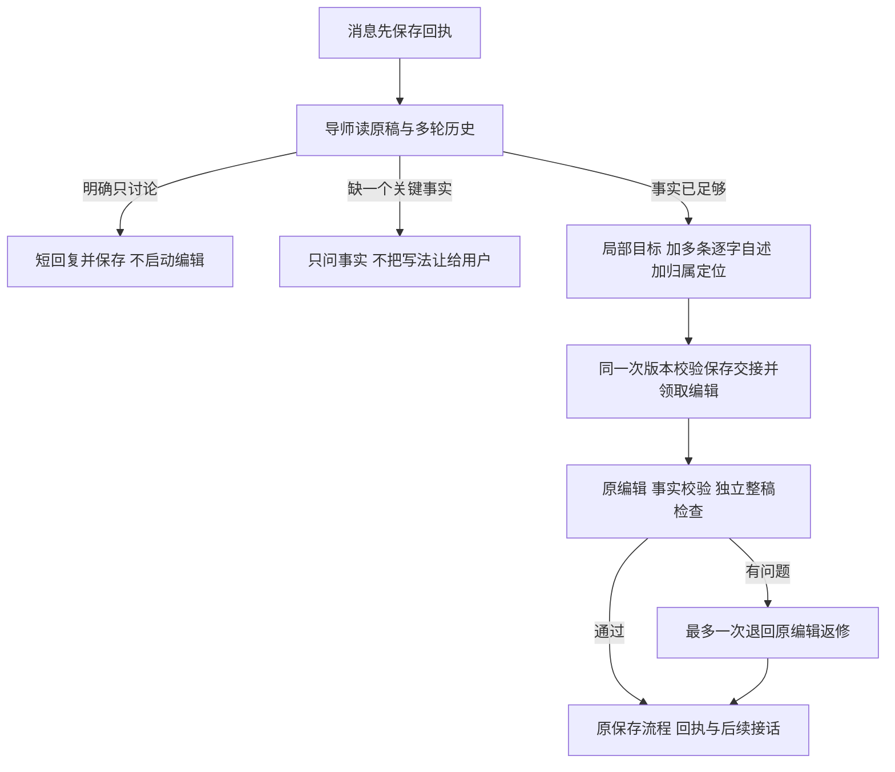

# 2026-10-24 简历导师讨论死循环与版式入口修复

## 状态

代码、3个虚构真实模型场景和本机版式验收完成，正式站仍为 a800e2d / 6eq。
候选部署和同构建提升将在完成后追加，不能把本段当成已上线。

## 实际故障证据

本人当前任务连续7轮已保存的导师决策全部为 discuss，事实回答交接0条，原6条修改仍是早期校对。
本次成功保存的7轮里编辑根本未被启动，不能解释成又一次编辑超时。
原生 Eval 运行 `3b90d442-1612-4582-b679-d4a19531e7c6` 是最后一轮，
`01214d91-04c7-48f9-bd70-a0393b69fd04` 是上一轮；它们没有 legacy Trace，不补造。
本人意见已关联原运行存入后台反馈 `89add37f-51af-437c-87bf-3775d742f7ff`。
实际简历、联系方式与完整私有对话没有复制进本报告或公共测试夹具。

根因有三层：

1. 导师把写法判断也当成待确认意图，没有停止追问的明确标准，反复征求写法同意。
2. 缺少短回复/不复述/不在聊天中先拟一稿等职责边界，导致长篇诊断和重复确认。
3. 旧交接只支持单条事实；动作、归属、用途在不同轮中出现时不能一起交给编辑。

未发现这7轮有重复的已保存消息。本次修的是语义重复与无编辑交接，不冒称定位到网络重发。

## 修后流程

不加知识整合 Agent，不以发消息/关键词直接触发改稿。
导师负责选择突出点和表达，只向用户问实际做过什么；没有数字也能写已有贡献。
提示约束40–120字、上限180字；不是截断长回复的前端遮罩，3个真实回复均符合约束。
最多4条事实保留各自消息ID、原话和原文锚。公司/项目标题上的 scope 只作 placements，
不要求编辑把“不是A，是B”的纠正口语写进简历。纯文本/OCR标题和真实数量范围分别有反例。
新字段兼容旧单条 supplement；旧任务不迁移、不重写。重放沿既有消息ID/CAS防重复语义。

## 真实模型验收和费用边界

本人批准最多3个虚构场景；实际3条导师调用、1条编辑、1条独立质检，共5次供应商调用。
不使用本人真实简历或绑定的 TokenDance，不调用原账号收费端点，不扣益职积分。
没有自动传输重试，没有为凑通过重跑导师。

| 场景 | 后台运行 | 结果 |
| --- | --- | --- |
| 多轮事实＋最后纠正归属 | 6d3b75cd-0f96-498a-9697-88d5750eb06e | 实际1条内容修改，独立整稿通过，保留参与/日期/列表 |
| 明确只解释、先不改 | 0b8de36d-0fe0-4c29-ba52-dba1f34d1c11 | discuss，编辑调用0 |
| 改后继续解释、不再改 | f44d5cc2-18b2-4d30-922c-e7286a8b3ee7 | discuss，不再追问数字、不重复编辑 |

真实编辑 Trace `39711b53-0a68-4330-a6ce-211c1ded51f6`，
修改ID `ai-change-1792850884764-0`；后台已有真实输入/输出、事实来源、知识、检查与成稿。
修改将“整理一些项目材料”替换为实际分析对象、对接方案与用途，不是换动词/修错字。
未提供的增长、转化率和“创新方法”没有编入。事实守卫关于“用于比较”的逐字匹配注记保留，
独立质检确认其来自用户说明的用途；未隐藏注记、未放松事实或收费规则。

首个运行 `8f62f9a2-8b97-4cba-ad22-07f560ee7c2f` 保留 failed：
导师决策正确，但验收脚本错误地要求锚必须带列表符号，且将标题定位也视作必写正文。
修复交接分类和验收断言后，复用该已保存的原始输出进入编辑，新增运行记录 replayOf；
没有再次调用导师。原失败记录未删除或改成成功。
总估价 USD 0.00633756，actualCost=null，不当真实账单。
14.1秒是保存输出回放后的编辑/检查这一段，不是重新完整走消息后的端到端速度对照。

## UI 与文件验收

- 三主操作共用13px、500字重、1.5行高、桌面40px/手机44px高度；去掉父级font简写覆盖。
- 版式从“更多”的透明原生下拉移到常驻“版式 · 当前名称”，六张视觉缩略图。
- 保留经典/蓝灰/温润，增加紧凑专业、人文书页、侧标履历；不是只有颜色不同。
- 工作稿与导出共用 printTemplates/resumePrintHtml，选择仍沿原偏好键保存，原文件不重排。
- Chrome本机实际切换、整页刷新恢复；390×844面板12..378px，document.scrollWidth=390。
- 修复面板打开后旋转/改变尺寸留在旧坐标的问题；Escape、箭头选择、轻触外部收起保留。
- 实际导出按钮打开正确的最终候选与所选版式，不擅改采纳状态。
- 原生打印控件仍对自动化超时，不冒称已点完系统另存对话框；使用同一排版器输出的HTTP文档，
  通过真实Chrome printToPDF生成6个PDF，共12页，逐页渲染检查；14个完整性标记和尾标全在。
- PDF有真实可提取文字。macOS无衬线字体的部分字映射为CJK部首（例如门），旧modern/warm已有；
  视觉正常，但不能据此保证所有ATS或逐字中文复制。这是明确保留的兼容性限制。
- 本轮未找到本人此前提供的模板原图，未声称这6款就是那些参考图的完整还原。

手动Impeccable detect一次：0 primary/12 advisory；其中模板色与7px为aria-hidden缩略图，
其余为原工具栏的陶瓷边/圆角。按用途保留，不开自动钩子，不扩大历史样式修复。
实际模型选择和渐进聊天组件未改；新字段不改公共对话返回结构，相关回归保留。

## 验证与原账号保护

- 全量297套：292通过/5原跳过；2,880项通过/10原跳过/0失败。
- 类型、改动文件lint通过；没有删除/降低质检、事实、计费或免费仅一段规则断言。
- 多轮事实保存、刷新读回、单次lease、重放不重复、仅讨论不改、迟到响应不覆盖均有存储回归。
- 原账号只读回查：任务version30、answers/result/conversation和当前岗位metadata与取证前完全相同。
- 真实模型核心在isolated模式，不传opportunityId/taskId/lease，offline预留直接跳过实际收费。
- 云端只新增本次Eval运行/反馈和审计元数据，没有替本人发送消息、重写原简历/作答或兑换积分。

本机持久化/存储回归、真实模型语义、浏览器模板与PDF是分开的证据。
未用虚构模型成功声称本人的原对话已经自动改好；旧回合保持原样，后续消息使用新逻辑。
