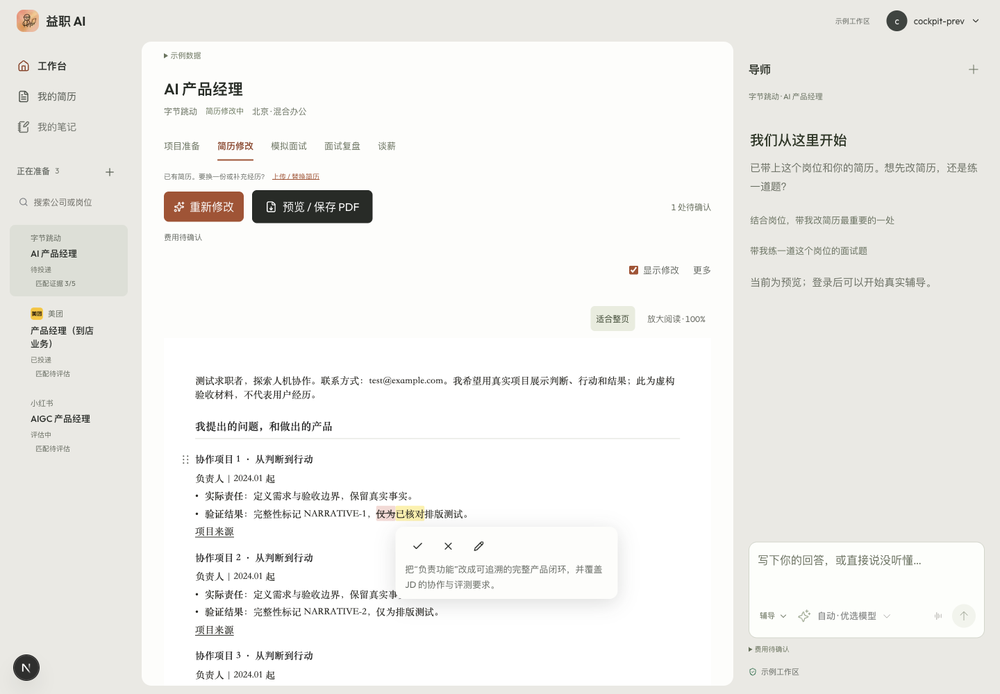
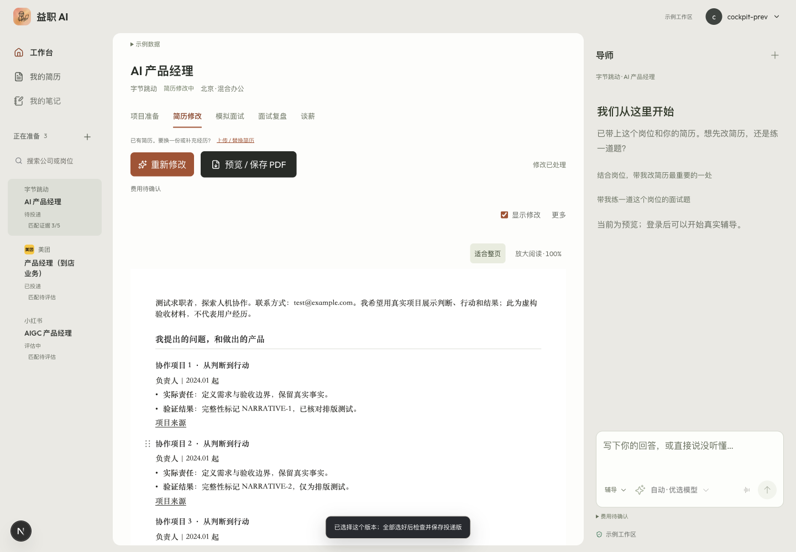
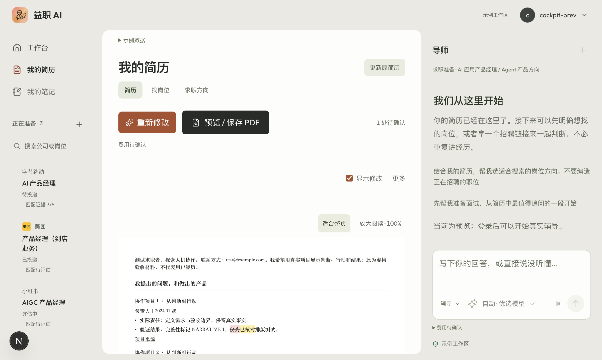
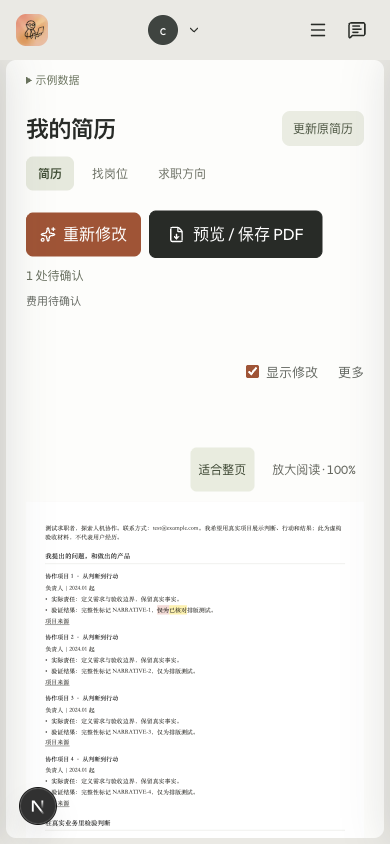
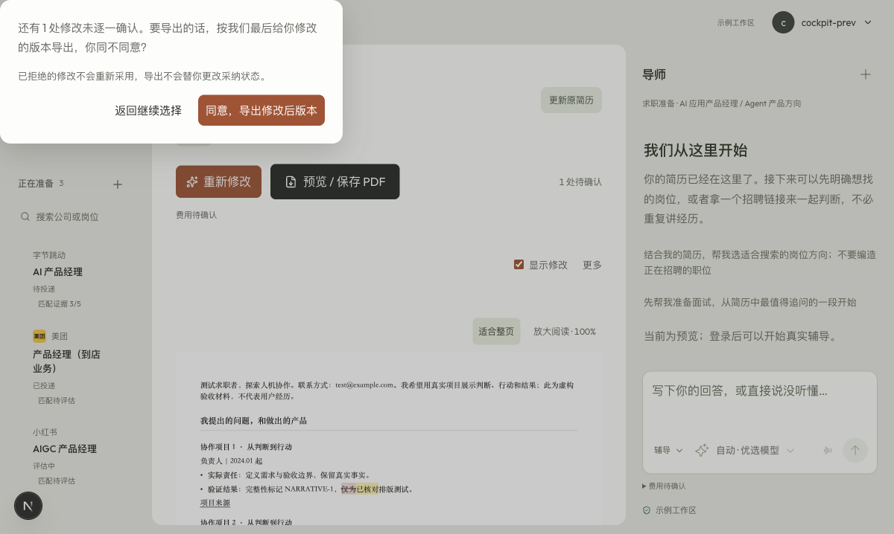

# 简历 Agent、使用流程与 UI 审查

日期：2026-10-15。审查基线：`21fb4e81a07c6fd27d14493dd78aa0bfbe0845bc`（文档 HEAD；运行时代码 `45ceae2`）。

## 结论

当前方向可以保留：原件独立、单纸面三色修改、局部采纳、补充先保存，以及用户认可的左侧栏。最需要补的不是新功能入口，而是「用户补充 → 确实修改 → 可以继续编辑 → 明确保存」的闭环。

本次复现了两处会让用户觉得“我明明回答了，却没有改”的逻辑问题；浏览器确认采纳后没有撤销/普通正文编辑入口、首屏操作区过高、导出确认框错位、手机纸面过小。建议先解决交付与编辑能力，再合并导师入口和工具栏，随后扩充细分案例与质量评测。不建议全站重做，也不重做左侧栏。

## 范围和证据边界

- 使用产品审查方法检查任务入口、交互、信息层级、错误恢复与可访问性风险；使用 agent-reach 检索原始资料，再读官方文档与 GitHub 源码。
- Chrome 扩展本轮仍超时。使用之前已授权的独立 Chrome QA 窗口，通过 CDP 操作当前源码的本地预览；不是声称修好扩展连接。
- 浏览器实际执行：打开简历、悬浮修改、采纳、无 JD 准备页、打开/取消导出确认、手机尺寸检查。数据均为产品自带虚构 fixture，没有操作用户旧作答。
- Agent 检查：直接运行当前 TypeScript 纯函数及当前 route 的检查表达式，三个确定性复现见下文；没有调用真实付费模型。
- 本轮**没有重新验收生产登录、云端保存后刷新、真实模型补问或实际 PDF 文件**；此前独立验收报告不混作本轮证据。UI 的本地可见状态不代表云端持久化。
- 竞品边界：ChatCut 本轮查看公开介绍页及编辑器演示；Teal 阅读官方操作说明；Reactive Resume 阅读实际源码。没有冒称本轮登录三家走完编辑器。
- 所有图均为本轮截图。未采用旧生产标签页截图；默认 fixture 的历史锚点不匹配也没有计为生产缺陷。

## 用户旅程健康度

| 步骤 | 用户目标 | 判断 | 本轮依据 |
|---|---|---|---|
| 1. 上传/进入简历 | 不选岗位也能改，原件原样保留 | 方向正确；本轮未重验上传 | 准备页和原件/修改稿分离的代码 |
| 2. 点击修改 | 先交付已有事实能支持的改善 | 已有先改逻辑；质量判断仍薄 | route 审查；不把旧“缺证据”问题重新报成未修 |
| 3. 补充经历 | 一次答一件事，接着改对应段落 | **高风险** | 最新回答覆盖、已采纳锚点合并两处复现 |
| 4. 审阅与修改 | 原位采纳、拒绝，也能自己改/撤销 | **不完整** | Chrome 采纳前后；编辑仅在待决气泡内 |
| 5. 保存/失败恢复 | 知道保存了什么，失败不重填 | 有基础；阶段反馈不足 | 已存回答与任务状态代码；本轮未重验云端 |
| 6. 导出 | 确认未决建议，检查页数和 PDF | 确认机制正确；布局/页数提示待补 | Chrome 弹窗和移动视口；未实际导出 |

## 应保留的部分

- 左侧两层导航、朴素背景和文档画布，不再加一套卡片式控制台。
- 绿色新增/优化、黄色表达修改、红色删除，以及显示开关和悬浮决定。采纳后去掉荧光标记符合用户要求。
- 原件、工作稿和建议不是同一份数据；不得因为编辑能力改造覆盖原件或旧作答。
- 用户事实与外部案例隔离、补充标为自述、回答先保存、并发租约/版本检查、有界修复。这些限制应留下，不以放松事实约束换取“终于出稿”。
- 未逐条确认时的导出同意流程；导出不能暗中改变采纳状态。

## 问题与具体改法

### F1 · P1：旧回答可以替最新回答通过检查

`app/api/coach/resume-draft/route.ts:165–168` 用两层 `some` 检查“任何建议引用了任何有用回答”。已有回答 A，再补回答 B，仅引用 A 也可以通过；这不证明 B 被处理。

**复现：** `latest_answer_not_covered` 返回 `currentGatePasses:true`，但 `newestAnswerIncluded:false`。这是检查逻辑可复现，不是对真实模型发生率的估计。

**改法：** 每次继续携带本轮待处理 answer ID、对应段落和工作稿版本。结果必须逐项说明本轮回答是“已用于修改 / 与现稿重复 / 不适合写入及原因”，再校验引用和实际文案；仅有 claim ID 也不能替代语义核验。其他段落已有的安全修改仍可交付，不重新全局阻断。

### F2 · P1：已采纳的段落会把后续新事实挡掉

`lib/opportunities/resume-agent-merge.ts:5–12` 为保护用户决定，丢弃所有与已决定锚点重叠的新建议。用户已经采纳某段，之后明确补充该段交付物，新建议仍被过滤。本轮 `accepted_anchor_followup` 最终只留下旧 accepted 项，新交付物不存在。

`lib/coach-harness/resume-task.ts` 在生成 route 完成后才合并；生成 route 已先保存候选 artifact 并结束额度结算。因此生成通过不等于用户最后看到的工作稿真的增加了修改。**这是代码顺序风险，本轮没有制造生产扣费订单。**

**改法：** 默认保留用户决定，但明确的“修改这一段/回答这一段补问”可以基于当前成稿创建下一版建议；不能继续依赖最初原文坐标。先完成合并与可应用性/新增价值检查，再判断任务交付成功。无新增交付不能冒充完成一轮改稿。

### F3 · P1：采纳后像成品，却不能继续编辑或撤销

Chrome 点击 ✓ 后标记确实消失；气泡和编辑入口随之消失。`components/cockpit/ResumeInlineReview.tsx:31` 仅选择 pending 建议，手改入口也只存在于该气泡；普通正文没有直接编辑入口。

**改法：** 荧光标记仍消失，但文字继续可编辑。提供标准撤销/重做；每次采纳、拒绝、手改、重排都是一个可恢复的编辑步骤。短暂显示“已采纳 · 撤销”，常驻工具只留小型撤销入口，不重新塞回多块建议卡。手改必须保存成新版本，不能被迟到模型结果覆盖。





### F4 · P1：一件改稿任务出现两个“导师”入口

`ResumeAgentConversation` 在纸面上方提问；右侧 `AgentConversation` 是另一套对话。后者能读简历上下文，但未发现与当前 resume task/question 的统一回答分发。在无 JD 页面，右侧默认邀请用户找方向或练面试，与当前改稿目标分散。

**改法：** 右侧只保留一个长期导师，在简历编辑场景绑定当前任务与段落；纸面显示结果，不再插入一套聊天表单。例：“这段写了整理反馈。最后交给负责人的是表格，还是其他材料？”用户回答后保存，更新对应段落并短暂提示定位。其他长期话题仍可切换，不删除原功能。



### F5 · P1：一次一问、跳过和“不必改”没有完整定义

- `resume-task-types.ts:53` 主要以问号数量限制一问。“当时要解决什么问题，你做了什么，最后交付了什么？”只有一个问号，却同时要三个事实；本轮函数检查接受它。
- `resume-draft/route.ts:187,195` 只要历史中有任一 `skipped`，后续自动补问全部关闭。应区分“略过这一问”和“这次不再提问”。
- 任务类型没有明确的“看过了，这部分无需修改”成功结果，空建议容易流向补问/失败。不要为了让 changes 非空制造无价值同义替换。
- `CockpitApp.tsx:1563` 的“继续补充”仍绑定生成动作，应聚焦当前问题，而非让按钮文字与实际行为分离。

**改法：** 问题结构只能包含一个事实槽位；按能改善当前段落的价值选择问题。允许不知道、跳过、稍后回答。每段独立标注已改善/保持原文/可选补充；不要求所有段落达到同一信息完整度才交付。

### F6 · P1：内部质量分主要是门禁，不是“改得好”

`resume-draft/route.ts:284–287` 的 100 分来自映射 40、独立复核 30、短句 20、ATS 10。它不直接测量是否使用最新补充、是否更易理解、是否保留重要事实、是否有信息增益，也不是候选人的能力分。

目前知识库只有四类 MIT 教学改写案例；`lib/knowledge/resume-examples.ts` 依靠字面标签与阶段启发式匹配，不等于用户要求的细分同背景优秀案例检索；公司研究也没有统一进入这条改稿编排。不能对外称这些都已完成。

**改法：** 内部 trace 分开记录事实保真、可应用性、最新回答处置、修改价值、可读性和呈现质量，保留逐项理由/引用，不提供虚假的总质量满分。先建设经授权或明确教学用途的小型细分案例集，按职能、阶段、经历形态、缺口检索；不匹配就不用。案例教取舍与表达，绝不能把别人的数字、职责移植成用户事实。用独立评测材料比较改前/改后，不只跑结构测试。

### F7 · P1：等待和恢复仍缺少可理解的阶段

`ResumeAgentConversation.tsx:13` 的 running 阶段只有一句笼统等待，330 秒后才出现重试；route 最大执行预算 300 秒。已有 durable task/回答存储不等于后台 worker 已完整落地。`resume-trace.ts` 的阶段记录也不能直接当成实时 UI 进度。

**改法：** 只展示真实的少量阶段，例如“读取材料 / 修改这一段 / 核对事实 / 保存”；保存状态与模型进度分开。支持安全结束本轮等待、回看已存版本、从已存回答继续；取消要使旧租约/迟到结果失效。不要用虚构百分比，也不要让刷新触发新的付费生成。没有有效新增改稿时如实告知。

### F8 · P1（手机）/P2（桌面）：纸面不是首屏主角

在 1200×718 CSS 视口，简历 iframe 从 y≈474 开始。标题/流程/替换提示/动作/费用/显示开关/缩放分成多排，首屏约三分之二用来放控制项。留白多并不自动等于舒适：用户要找的内容被下推了。

390×844 时虽然没有观察到横向溢出，A4 被整体缩小，文字和修改目标已经不适合触摸阅读。缩放能力存在，不代表默认状态好用。

**改法：** 保留左栏；简历区域上方只留一条紧凑工具栏：名称与保存状态、撤销、显示修改、更多、导出。初次的主要动作是“开始修改”，出稿后的重点转为审阅与导出，“重新修改”降为次级。模板仍藏在更多中。纸面用很轻的边缘/阴影与周围区分，避免新增区块框、分割线和图标。

移动端保留可缩放纸面预览，同时点击段落可进入可读字号的同一份局部编辑视图；不是把整张 A4 缩小后要求用户点细小色块。触控目标、键盘焦点、纯颜色之外的含义都需验收。本轮不构成 WCAG 合规认证。



### F9 · P2：导出确认框出现在左上角

Chrome 实测原生 dialog 为 `x:0,y:0,width:460,height:192.75`，computed margin=0、position=fixed、inset=0。`CockpitApp.module.css:1401` 没有补居中 margin；全局重置后的效果不符合预期。确认内容和取消行为可用，定位有明显问题。

**改法：** 明确 dialog 的视口居中、窄屏边距和最大高度；打开时焦点进入、关闭后回原导出按钮。只修该弹窗，不扩成全站弹窗系统重写。



### F10 · P2：一页目标、原件保真与保存文案要一致

- 当前纸面缩放主要按宽度适配；“适合整页”不等于内容实际只有一页，也没有可靠的即时页数预算。本轮未实际导出，不判定特定 PDF 超页。
- 原文件可以原样展示，但修改稿经文本提取、分块和模板重排，不能据此承诺完全保留原件的字体、照片和布局。须明确“原件预览”和“可编辑成稿”的能力界限。
- 采纳提示仍写“全部选好后检查并保存投递版”，而无 JD 准备页没有同样的检查入口，容易让人以为刚才采纳没有生效。

**改法：** 采纳与保存分别提示“已采纳 / 保存中 / 已保存 / 未同步，重试”。导出前按实际渲染计算页数；先精简长句、减少冗余和调整间距，不能靠极小字号或删除事实凑一页。姓名、电话、邮箱与照片区域按既定要求处理；原件永远留存，替换必须确认。

## 竞品与源码：只学适合益职的部分

| 参考 | 本轮查看深度 | 值得借鉴 | 不照搬 |
|---|---|---|---|
| [Teal：Using AI Bullets](https://help.tealhq.com/en/articles/9519206-using-ai-bullets) | 官方操作说明 | 针对一条 bullet 改写；Coach Me 帮用户找到任务/影响；JD 是可选上下文 | 三种候选与很多模式不全部塞给用户；其说明允许 AI 产生不准确指标再让用户改，益职不能采用这个事实策略 |
| [Reactive Resume](https://github.com/reactive-resume/reactive-resume) | 实际 MIT 源码，固定提交见下 | 采纳作为可撤销编辑步骤；保存/离线/失败明确区分；按真实渲染调页数；当前选区变了就不覆盖 | 不整体移植编辑器侧栏或自动“加结果”提示，不用过小字号换一页 |
| [ChatCut](https://chatcut.io/) | Chrome 公开首页及编辑器演示 | 成品画布是视觉中心，输入与结果并置，控制项围绕当前任务出现 | 不搬时间线或视频工具布局；未把演示当登录编辑器全流程实测 |

Reactive Resume 本轮读取的代码版本：`19e0518eb5ea1b2c84d785bc5ea2b6d6c9d7b043`。

- [proposal 采纳和撤销](https://github.com/reactive-resume/reactive-resume/blob/19e0518eb5ea1b2c84d785bc5ea2b6d6c9d7b043/apps/web/src/features/resume/editor/proposals/proposals.ts)
- [保存状态](https://github.com/reactive-resume/reactive-resume/blob/19e0518eb5ea1b2c84d785bc5ea2b6d6c9d7b043/apps/web/src/features/resume/editor/save-status.tsx)
- [按渲染结果适配页数](https://github.com/reactive-resume/reactive-resume/blob/19e0518eb5ea1b2c84d785bc5ea2b6d6c9d7b043/apps/web/src/features/resume/editor/design/fit.ts)
- [局部改写与当前选区检查](https://github.com/reactive-resume/reactive-resume/blob/19e0518eb5ea1b2c84d785bc5ea2b6d6c9d7b043/apps/web/src/features/resume/editor/write/improve.tsx)

## 建议的 Agent 和交互契约

一条任务链，不再加多个独立 Agent 入口：

`原件留存 → 已有事实先改 → 纸面展示建议 → 右侧可选一问 → 回答先保存 → 基于当前版本局部改稿 → 校验合并后的实际成稿 → 采纳/拒绝/手改/撤销 → 云端确认 → 导出`

最少保留五类明确状态：不可变原件、带版本的工作稿、带原句/事实引用的建议、当前问题及已保存答案、用户决定与撤销历史。一个任务 ID 贯穿，不让长期导师另建一套补问状态。

知识检索只提供适用写法；公开公司资料只影响取舍和岗位语境，不成为个人经历证据。未知结果允许保留，不强迫用户提供数字。对外只呈现用户要处理的一步；面向开发者的 trace 记录来源、修改范围、检查结果、耗时/费用与拒绝原因，不暴露内部推理过程或给用户暗打能力分。

## 实施顺序与验收

### 第一批：让改稿真的交付、可修改

修 F1/F2；补普通正文编辑与撤销；统一补问到右侧；修导出框定位。保留左栏和三色语义，避免先换整套视觉。

1. 回答 A 后再答 B：B 有明确处置；不能仅引用 A 就宣布 B 改完。
2. 已采纳段落再补交付物：新增事实可形成下一版建议；其他已拒绝意见不复活。
3. ✓/×/手改/撤销后均能保存并刷新恢复；迟到结果不覆盖新手改。
4. 一次只问一个可回答事实；不知道/跳过不导致其他段落不能用，也不永久禁用所有问题。
5. “无需修改”可以完成任务；不可把空交付伪装为成功改稿。

### 第二批：把工作区收成文档编辑体验

工具栏合并、主次动作按阶段切换、保存状态靠近文档、移动阅读与编辑适配、真实页数提示。候选尺寸在 1200×718、1440×1000、390×844 检查，不仅在大屏截图上好看。

6. 桌面首屏直接看到足够的简历正文；没有堆叠的阶段说明、重复标题、永久拖拽说明。
7. 键盘/鼠标/触屏都能处理建议；采纳后仍能编辑；关闭标记只隐藏差异，不改变决定。
8. 导出确认居中，取消回原按钮；PDF 实际保存并打开，验证内容、页数、姓名联系方式、头像留位与三色关闭后的成稿。

### 第三批：提高改稿质量与可恢复性

扩细分教学/授权案例，增加真实有用性评测；真实阶段与后台执行能力一起补，避免只做“正在思考”动效。

9. 评测覆盖普通职责、无量化成果、密集叙事、无 JD、已很好不必改、多轮补充、否定责任、长简历；明确每条建议改善了什么。
10. 断网/超时/并发时回答仍在，只产生一个有效交付；恢复后不重复生成或把旧版本覆盖回来。

## 可复现证据

浏览器截图目录：`docs/product/assets/resume-agent-ux-20261015/`。均为虚构数据，不含用户真实简历。

复现脚本：[repro.cjs](assets/resume-agent-ux-20261015/repro.cjs)。在产品根目录运行 `node docs/product/assets/resume-agent-ux-20261015/repro.cjs`，直接加载实际模块；未把另写的伪逻辑当生产代码。基线变更后应重新核对实现，不能把这些缺陷输出当回归通过。输出：

```json
{"case":"accepted_anchor_followup","retained":["accepted"],"newSupplementVisible":false}
{"case":"latest_answer_not_covered","currentGatePasses":true,"newestAnswerIncluded":false}
{"case":"multi_fact_single_question_mark","accepted":true,"question":"当时要解决什么问题，你做了什么，最后交付了什么？"}
```

本轮是审查与方案，没有改运行时代码、上线、购买服务、修改用户数据或旧作答。相关改法尚待实施及真实登录 Chrome 验收。
