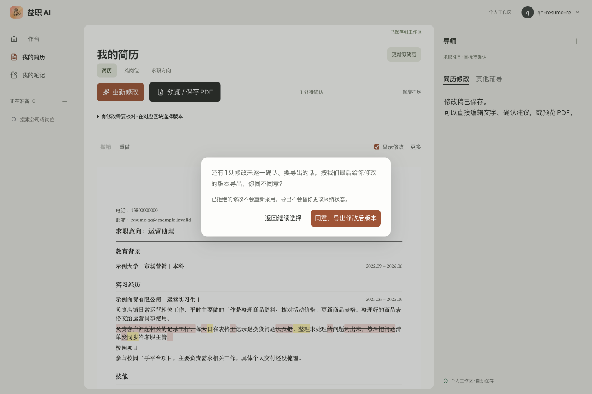
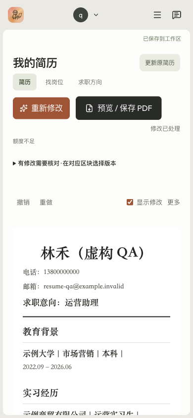
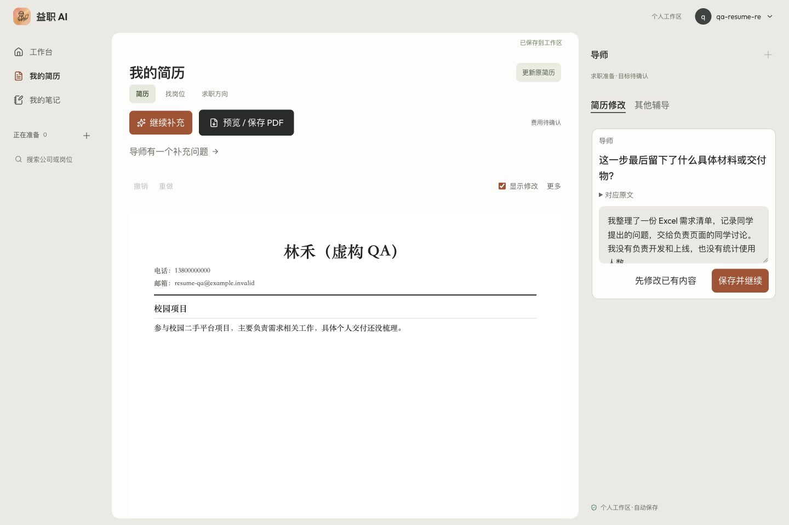
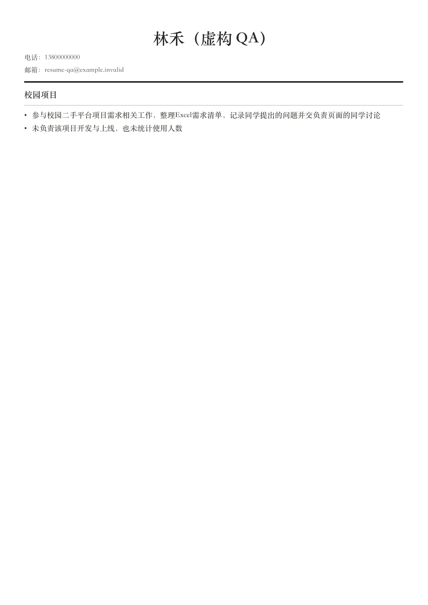

# 简历 Agent 与编辑体验：首批修复及正式站验收

日期：2026-10-15。对应[专项审查](2026-10-15-resume-agent-ux-audit.md)。

## 结论与范围

用户明确：**未认可“单纸面三色”为设计偏好，以使用体验为主；认可的左侧栏保留，旧作答不动。** 本轮不以全站换皮替代功能修复。

首批已修最新补充未被交付、已采纳段落不能继续补改、普通正文不能编辑/撤销、两个补问入口、导出弹窗定位和手机阅读问题。真实 Chrome 又发现输出 JSON 失败泄漏英文、首轮进度未显示、明确缺失交付物却落入重试，已续修并上线。

**没有把审查十项全部标完成。** “无需修改”的明确结果、改稿价值判断、细分案例检索、后台续跑/取消与真实阶段仍待做。实测有一份只有技能标签变化，也有一份把“不负责开发”等边界直接写进正文：它们没有捏造事实，但不能算高质量求职成稿。

## 发布

- 最终运行提交：`0ac2a3c`。本批还含 `abe0ab0`、`4846af0`、`c978f3a`。
- 正式部署：`dpl_84YJxhcKqy52KhXUzNXSFmxfRNWE`。
- `www.ai-job-coach.xin` 与 `ai-job-coach.xin` 均解析到同一 READY 部署；两域 health 均为 `ok:true,database:ok`。
- 精确部署近 10 分钟 error 日志的限定查询无返回；这不是长期无错误保证。
- 没有数据库迁移、套餐升级、充值或手调额度。

## 实现与边界

| 审查项 | 已落地 | 边界 |
|---|---|---|
| F1 最新补充被旧引用冒充 | 校验最新有效回答的 claim、原文锚点与合并后可交付建议，旧回答不能替代；任务实际提交后才成功结算 | 引用检查加独立事实复核，不等于通用语义质量已解决 |
| F2 已采纳段落挡掉新补充 | 用户明确补该段时允许生成下一版 pending；拒绝新建议可恢复之前的已采纳内容；提交前检查并发决定 | 仍要求精确原文锚点，歧义/多段重叠不强行覆盖 |
| F3 不能继续编辑/撤销 | 普通正文有就近编辑；采纳、拒绝、手改、重排可撤销/重做；历史上限 15，绑定生成版本并保存 | 新一代生成不会套用上一代撤销历史；不影响原件/面试答案 |
| F4 两个导师入口 | 当前简历问题放入右侧导师，单个可见输入区；“其他辅导”保留长期对话，不删除历史 | 不是所有聊天意图已统一为一个智能路由 |
| F5 一问/跳过 | 复合问题归一到单事实槽；跳过不永久禁用其他问题；继续补充定位当前问题 | “无需修改”独立成功状态仍未做 |
| F7 等待/恢复 | 生成初始状态也继续轮询；坏 JSON 进入一次有界修复，再失败用中文提示；失败保留回答可续做 | 完整后台 worker、取消与分阶段进度未做 |
| F8/F9 阅读与导出 | 移动端默认可读字号；隐藏面板不拦触摸；模板留更多中；导出确认居中 | 桌面顶部仍有可收紧空间；没有宣称审美已获认可 |
| F10 段落识别 | 校园/课程/个人/开源/科研项目标题独立分块，不再并入上一段 | 没有承诺任意原文件字体/照片保真或任意长简历一页 |

明确写着“具体交付还没梳理”的材料：先尝试已有事实能支持的修改；没有安全交付且尚未回答补问时，才给一个对应原文的交付物问题。普通模型失败不能一概归咎用户缺材料，回答后也不会被这个兜底反复问同一题。

## 真实 Chrome 验收

使用独立 Chrome QA 窗口、正常免费测试邀请码登录、仅虚构材料。没有复制用户 Cookie，没有操作真实账号的付费模型或付费岗位推荐。扩展连接仍不计为修复，本轮使用既有授权的 CDP 通道。以下是实际正式站，而非示例预览。

### A：普通简历，没有 JD、没有补充也能先改

粘贴虚构运营助理简历，包含教育、两条实习职责、信息不足的校园项目和技能。

1. 初次真实调用产生 JSON 解析错误，出现英文内部错误；已加入有界修复与中文失败提示，失败未结算成功。
2. 刷新后通过页面重试，约 62 秒得到一条实际精简：
   - 原句：负责客户问题相关的记录工作，每天在表格里记录退换货问题以及把未处理的问题列出来，然后把问题清单发给客服主管。
   - 新句：每日在表格记录退换货问题，整理未处理问题清单同步给客服主管。
3. 另两条未通过事实校验的候选没有交给用户；安全项仍可交付。信息不足的校园项目没有全局拦住这次修改。
4. 悬浮/选择建议 → ✓ → PATCH 200 → 刷新：已采纳文本仍在，标记未复活。
5. 普通已采纳段落 → 编辑 → 增加虚构测试后缀；只让当前页的保存 PATCH 发生 `internetdisconnected`。页面提示云存失败并保留稿件。
6. 恢复该请求 → 重试保存 200 → 刷新，手改仍在。撤销 → 保存 → 刷新恢复 AI 已采纳稿；重做可恢复手改，最终再撤销测试后缀。

这是**当前页请求故障注入**，不是实际上游模型超时，也不是关闭整机网络。首次模型输出失败是真实发生的，两者区分记录。

未决导出确认框实测 1440×960 下约 `x490,y383.625,w460,h192.75`，取消返回；390×844 下 scrollWidth 为 390，纸面正文为 16px 阅读视图，无横向溢出。实际导出 PDF 一页 A4，检查文字层与完整渲染：最终修改在，测试后缀和控制按钮不在。修正校园标题后重新导出目视，没有竖排标题或重叠。

### B：薄材料暴露改稿价值不足

只有教育、模糊校园经历和 Excel/Word 的样本，实际模型只把“Excel、Word”改成“办公软件：Excel、Word”，没有补问。结构/事实门禁通过，**但只算链路运行，不算有价值改稿验收**。现有质量 trace 不能发现所有这类无意义小改，后续应加入无须改动/无价值修改判定。

### C：一个补问 → 回答先保存 → 重试 → 真实改稿 → 采纳刷新 → PDF

只有身份信息和“参与校园二手平台项目，主要负责需求相关工作，具体个人交付还没梳理”的样本，最初两次内部候选失败落入通用重试。补丁 `0ac2a3c` 后，从页面重试得到一个问题：

> 这一步最后留下了什么具体材料或交付物？

UI 对应原文正确。虚构回答：

> 我整理了一份 Excel 需求清单，记录同学提出的问题，交给负责页面的同学讨论。我没有负责开发和上线，也没有统计使用人数。

1. 仅中断当前页 POST resume-agent，回答留在输入区；恢复网络并刷新后，草稿恢复。
2. 保存并继续；任务仍在运行时独立读数据库，确认回答与 claim 已先持久化。
3. 第一轮生成被事实校验拦下，回答未丢且未成功计费；刷新后选择从已保存材料继续，不重填、不新增材料。
4. 下一次实际生成 ready，两条正文引用最新回答的 claim，独立复核通过：
   - 参与校园二手平台项目需求相关工作，整理 Excel 需求清单，记录同学提出的问题并交负责页面的同学讨论。
   - 未负责该项目开发与上线，也未统计使用人数。
5. 选择 ✓ → 保存 200 → 刷新：两条仍在、状态 accepted。独立数据库读回 ready、1 条回答、最新 claim 引用一致。
6. 实际 UI 导出窗口后写出 Chrome PDF，29,538 bytes、1 页 A4；检查文字层和完整渲染。不是只打开打印对话框。

这里证明了补充交付、事实边界与恢复链路；**第二条否定责任说明虽忠实，但不宜直接当求职 bullet，应留在内部事实边界而非正文。这是仍待改进的内容取舍，不包装成质量成功。** 短样本的一页不等于长简历自动一页。

[本轮虚构 PDF 原文件](assets/resume-agent-ux-fixes-20261015/guided.pdf)

## 自动验证与 UI 检查

- `npm test -- --runInBand --silent`：226 套、2200 项通过；5 套/8 项 opt-in live 测试跳过，不把跳过算通过。
- `npx tsc --noEmit` 通过；修改文件 ESLint 0 错误，Cockpit 原有两处 hook 警告保留，未扩修。
- 最终 `0ac2a3c` 精确归档的 Vercel 云构建成功；`git diff --check` 通过。
- 新回归含最新回答覆盖、精确已决定锚点重开/拒绝恢复、普通正文编辑、撤销历史版本隔离、复合问题、显式缺口一问、校园标题识别和任务已提交后的幂等恢复。
- 按前端品味 skill 使用留白/层级而非新增卡片模板；Impeccable 手工一次检查和一次有限复核，自动钩子关闭。未见本批新增主要项；旧 interview 样式/字号项仅记录。此项不等于用户审美验收。
- 此轮没有重新上传原文件或执行替换确认，相关组件未改；不拿前轮结果冒充本轮重新验证。

## 数据保护与清理

三组 QA 标签为 `qa-resume-review-20261015-a/b/c`，仅本轮虚构账号。正常登出后按精确 ID/email 对删除自己的 3 个 public/auth 用户及 3 个邀请码；其测试机会/任务/材料随之清理。回查 public/auth 用户、邀请码、机会、任务均 0；本轮没有上传云端原件。复现图和 PDF 保留在本报告。

旧面试作答 41 条，前、中、后采用同一整行 JSONB 聚合方式检查，MD5 均为 `9e144836009b5eb9bfe09dec0ac90d32`，没有改旧作答。

## 后续优先级

1. 先补“有价值修改 / 保持原文 / 可选补充”的明确结果；去除无意义标签改写和不适合进入简历的否定说明。事实门禁不应替代内容取舍。
2. 内部 trace 分开事实保真、最新补充处理和修改价值；不能继续把有限门禁 100 当改稿质量满分。扩充经授权/教学用途、相近阶段和经历的案例，当前四类教学样例不足。
3. 持久后台执行、真实阶段、取消与旧结果失效；本轮不是这些基础设施的完成证明。
4. 继续压缩顶部工具区、做真实页数预算，多份密集/长篇/带照片授权简历验收后再扩大排版承诺。

ME 业务状态只更新本线，不提交或推送共享脏暂存区；产品分支仅包含本任务文件，原有无关未跟踪文件不加入提交。
