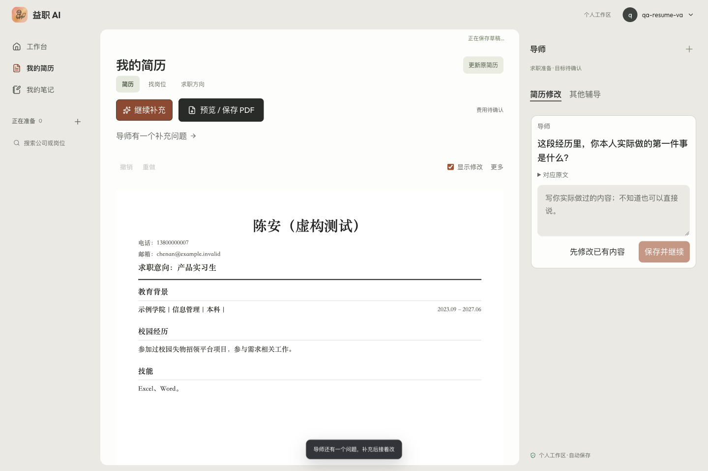
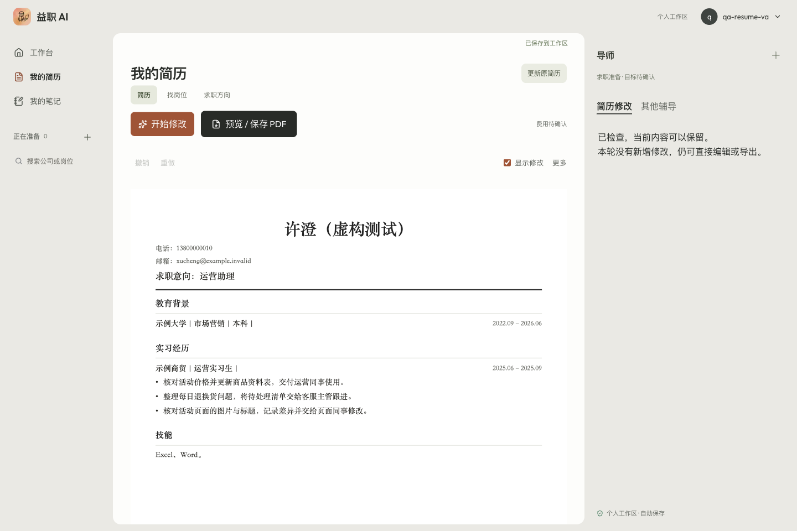
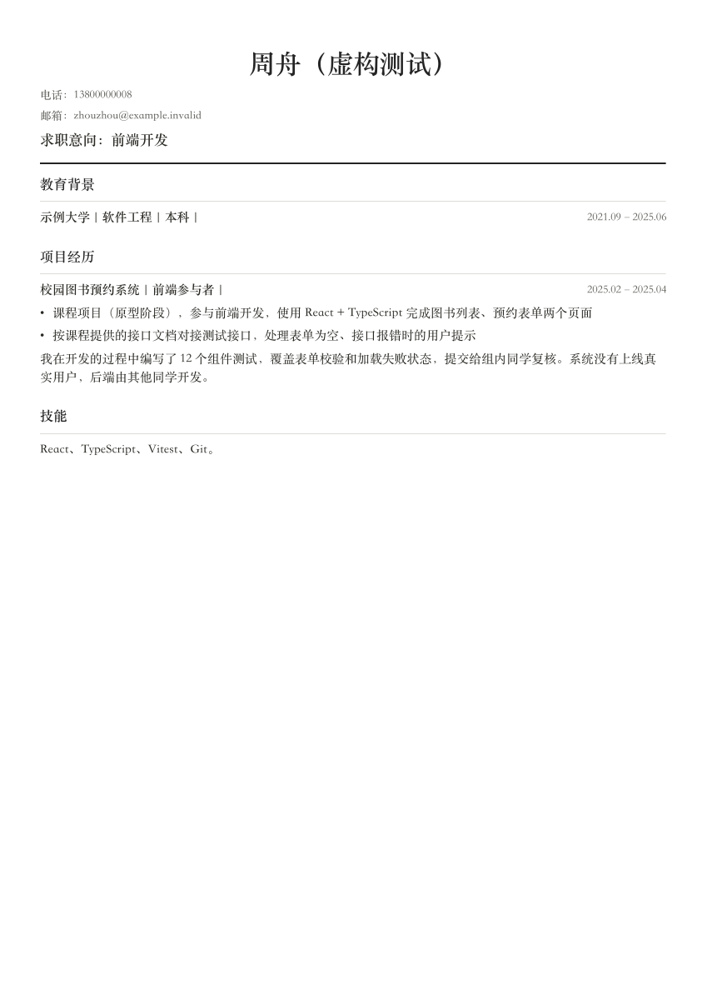

# 简历改稿价值与逐问回流：修复及验收

日期：2026-10-15。续接[上一批体验修复](2026-10-15-resume-agent-ux-fixes-acceptance.md)。本轮不重做左栏，不修改用户旧作答；单纸面三色不是用户已认可的审美偏好。

**已发布：运行提交 a4f7fbe，部署 dpl_Gm9gMs6LSrETyiQnoDgPqyGCo87C。** 普通运营、薄材料补问、技术长段、清楚原文保留四类已实际走过；五份最终工作稿 A/B/G/H/J 均做保存后刷新与实际 PDF。中间失败版本明确保留在下文，不计入质量通过。

## 本轮修改

- 先改已有事实能支持的冗余、长段和信息结构；没有 JD、数字或外部证明，不是拒绝普通经历改稿的理由。
- 事实校验与编辑价值分开。独立复核必须逐条给出实际改善依据；只有“办公软件：”、技能分类/换序、同义词替换不能算交付。
- “没有负责开发/上线、没有统计人数”留在内部事实边界，不写成本人求职 bullet；其他人的分工也不凑成本人的经历。参与/协助、课程项目、原型等决定事实含义的限定仍保留，不能借精简扩大职责。
- 只有模糊职责的段落不能通过拆成空泛 bullet 冒充改好。先尝试整份中可安全改善的内容，再就缺口一次问一个事实；多个事实藏在一个问号内、带长示例的问题归一为单事实槽。
- 已保存的正向补充必须用于对应段落，不能靠改技能栏冒充完成。补充中的否定责任说明不能自动变成新的简历条目。
- 无新增修改是合法结果，但必须另一次独立复核确认；保留现稿与已有决定，不成功扣额。模型失败不冒充“无需修改”。
- 真实运行暴露模型空响应；加入一次有界修复，与现有修复共用上限。补充/原文不丢失，失败不结算成功。明确的 `；- ` 列表分隔规范化为真正短 bullet，不改源材料。
- Owner trace 分记编辑价值、保留/拒绝数量、无需修改与失败；不记录私有推理过程，不给求职者能力打分。

## 真实 Chrome 方法

独立 Chrome QA 窗口，正常免费邀请码登录，全部使用明确标记的虚构材料和 `example.invalid` 邮箱。没有接触真人旧简历/旧作答，没有充值、手调额度或调用真人付费推荐。Chrome 扩展仍未计为修复，使用先前已授权的本地 Chrome CDP 通道。

候选部署保护通过现有 Vercel CLI 身份建立限定候选域会话；没有关闭部署保护、改变 trusted-source 设置或导出用户 Cookie。实际点击导入、开始修改、回答、采纳、刷新、导出；真实模型为 StepFun `step-3.7-flash`，不是 mock。保存后比较完整纸面文字，PDF 从真实导出窗口写出、检查页数/文字层并逐页目视。

## 质量案例与过程中发现的问题

### A · 普通运营，无 JD，无补充，已有事实直接改

三条普通职责各有实质精简，技能未动。例如：

> 原：平时主要负责店铺商品资料相关的整理工作，工作内容包括核对活动价格、更新商品资料表格，然后把整理好的表格交给运营同事使用。
>
> 改：核对店铺活动价格，更新商品资料表格，整理后同步给运营同事使用。

另外两条保留退换货登记/待处理清单/主管跟进，以及页面图片标题核对/差异记录/交给页面同事。三处各自采纳、PATCH 200、刷新正文完全一致；实际 A4 PDF 一页，无控制按钮或裁切。真实生成约 45.2 秒。

首轮独立复核没有拿到一致的引用字段与价值输出格式，已统一 `sourceIds` 与明确 JSON 契约后复验。不能以首轮模型 API 成功冒充成稿成功。

### B · 模糊校园经历，补充后写实际贡献

起初只有“参加过校园二手平台项目，参与需求相关工作”。保存补充：

> 我整理了一份 Excel 需求清单，记录同学提出的问题，交给负责页面的同学讨论。我没有负责开发和上线，也没有统计使用人数。

真实改稿约 43.5 秒：

> 参与校园二手平台项目：整理一份 Excel 需求清单，记录同学提出的问题并提交给负责页面的同学讨论。

没有写“没负责什么”，也没有改成负责开发或产生增长成果。采纳保存、刷新、实际一页 PDF 通过。

补充提交时另做当前页请求故障注入：POST 被中断后输入仍在，刷新后草稿恢复；恢复请求后继续成功。这是受控网络故障，不冒称真实模型超时。真实模型空响应另在 D 发生并记录。

### 未通过的中间版本不能算验收

- C 技术经历：真实模型删掉“课程项目”性质，相关建议被挡；却交付了技能分类包装。已将类别标签换皮也纳入确定性过滤，并把被拒候选原因纳入有界修复反馈。
- E 薄材料：把“参与需求相关工作”改成“协助梳理需求相关内容”并拆条，独立模型仍误判有价值。新增原文模糊职责检测，只有该段获得正向事实补充才可交付，不全局阻断其他段落。
- F 技术复测：保留课程/原型性质并精简了真实动作，但仍把其他同学的后端工作写成一条，且用 `；- ` 伪装换行。追加归属说明过滤与明确列表分隔规范化，未采纳此版本。
- D 清楚短简历首轮：上游返回空正文（`empty_response`），未扣额、原文保留。不是用户缺证据，也不能推断成稿已好；增加共用修复预算的一次空响应修复。
- D 再测：模型交付“记录差异并交给”→“记录差异后移交”，独立模型也误判为有价值。本轮未采纳，加入交付连接词/同义词规范化；纯装饰性候选全部被挡后，允许独立检查原文是否应保留。带事实/归属错误的候选不走这一捷径，未处理的正向补充和明确缺口也不能被“无需修改”吞掉。
- I 再测仍有近义包装：把“将待处理清单交给”改成“生成待处理清单并交付”。未采纳，最终改为对短句的长度/结构/编辑距离判断，而非枚举交付近义词。明显精简、长段拆条仍可过审；有已引用、锚定的正向补充不按近义微调拦截，仍须独立事实与价值复核。这是保守规则，不是通用语义等价证明。

### G · 单事实问题与正向贡献复验

94b5ef1 候选上，另一份薄材料实际返回单问：“这段经历里，你本人实际做的第一件事是什么？”（约 43.9 秒）。回答同样含正向动作与未负责开发等边界，约 35.0 秒完成：

> 参与校园失物招领平台需求相关工作；整理Excel需求清单，记录同学提出的问题并提交给负责页面的同学讨论。

只写实际贡献，无否定责任 bullet，无技能标签凑修改。逐处采纳、保存刷新一致；实际 PDF 40,255 bytes、1 页 A4，文字层与完整渲染已看，无裁切、重叠或按钮混入。

### H · 技术长段：先交付通过的实质修改

7d1b56b 候选上，真实生成约 40.5 秒。长段改为：

> - 课程项目（原型阶段），参与前端开发，使用 React + TypeScript 完成图书列表、预约表单两个页面
> - 按课程提供的接口文档对接测试接口，处理表单为空、接口报错时的用户提示

课程/原型/参与的性质保留，技能列表没有分类包装。一处建议采纳后保存、刷新全文一致。实际 PDF 57,141 bytes、1 页 A4，渲染有真正的两条 bullet，无横向裁切。

第二段模型仍带“后端由其他同学开发”，被新规则拒绝，**这一段保留原文**，没有声称整份所有段落都已优化。原始材料里既有的归属说明未被静默删除；本轮保证新建议不再把这类说明凑成本人贡献。安全的第一段先交付，没有全局失败。

### J · 已经清楚的简历，保持原文并释放额度

最终运行 a4f7fbe，约 51.1 秒。两次候选中的装饰性修改被挡，第三次独立检查原文确认无需修改。实际返回 ready、`unchanged:true`、`changes:[]`，页面显示“已检查，当前内容可以保留。本轮没有新增修改，仍可直接编辑或导出。”

刷新后上述状态与完整原文仍在；数据库只读回查免费改稿额度仍 1 次、付费额度 0，无成功扣额。实际 PDF 47,378 bytes、1 页 A4，三条原有 bullet、姓名/联系方式分行与日期对齐都保留。并非失败时默认判好，也不是只跑了 mock 的无需修改分支。

[运营修改 PDF](assets/resume-edit-value-20261015/operations.pdf) · [补问后 PDF](assets/resume-edit-value-20261015/guided.pdf) · [技术简历 PDF](assets/resume-edit-value-20261015/technical.pdf) · [无需修改 PDF](assets/resume-edit-value-20261015/unchanged.pdf)

## 最终版本、正式域名与数据保护

- 最终 a4f7fbe 从 Git 精确归档到独立发布目录，构建为 `dpl_Gm9gMs6LSrETyiQnoDgPqyGCo87C`；完成候选验收后 promote，没有直接发布未验的中间版本。
- A/B/G/H 在最后候选正常重新登录，现有采纳稿刷新后全文相同，右侧任务完成状态恢复；重新导出四份 PDF，整页渲染与此前逐页检查的 PNG 字节一致。J 在最后候选真实生成“无需修改”，随后在正式 `www.ai-job-coach.xin` 再正常登录、刷新和导出，状态/正文一致，PDF 渲染也一致。
- www 与裸域均查得同一 READY 部署；两域 health 为 `ok:true,database:ok`，匿名 resume-agent 401。精确最终部署近 10 分钟 error 日志限定查询无返回，不代表长期稳定性统计。
- 最终验收 PDF 均为一页 A4：A 48,989 bytes、B 39,728 bytes、G 40,255 bytes、H 57,141 bytes、J 47,378 bytes。短样本没有塞满页面，不用装饰和编造经历凑一页。
- 全部账号正常退出后，按预先核对的精确 ID/email 对清理本轮 a–j 共 10 组 public/auth 用户、10 邀请码与免费测试额度；测试机会、任务、材料级联清理。回查用户/邀请码/机会/任务/额度/claims 均 0。没有上传云端原件，无真实用户材料被删除。虚构验收 PDF/截图保留；无正文 Trace/模型用量审计保留。
- 旧 `interview_answers` 前、中、后均 41 条，整行 JSONB 按 id 聚合 MD5 为 `9e144836009b5eb9bfe09dec0ac90d32`，未改旧作答。
- 产品只提交本任务文件；未混入旧 Chrome 诊断、Impeccable 流程输出、Supabase 临时目录。ME 业务三处状态在共享工作树更新、不提交，避免夹带其他会话暂存内容。

## 自动检查与边界

- 227 套、2229 项通过；5 套/8 项 opt-in live 跳过。PDF 模块使用仓库需要的 `NODE_OPTIONS=--experimental-vm-modules`，不把缺该启动参数的首次失败算产品缺陷。
- 类型检查、修改文件 ESLint、diff 空白检查通过。精确提交归档构建，不混入其他任务未跟踪文件。
- 本次 UI 仅“无需修改”的状态文案；手动 Impeccable detect 一次，无新主要项，5 个历史颜色 advisory 不扩修，自动钩子未打开。
- 样本是一组不同经历/详细程度的虚构简历，不代表所有行业、模型或任意长简历都已稳定。短样本一页不等于任何长简历强行一页。
- 本轮没有重新上传原 PDF/替换原件，没有扩充知识案例库、重做公司研究编排或把生成改成后台任务。其他聊天改稿入口不借本轮验收扩大签收。
- 本轮验证的是托管免费额度的预留/释放，不承诺 TokenPay 外部提供方已发生的模型用量可以退款；TokenPay 按用量计费规则未改。
