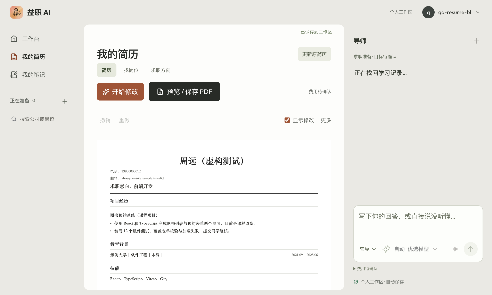
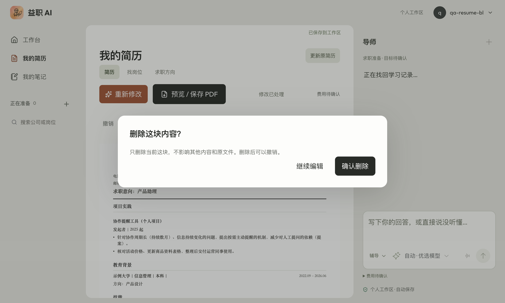
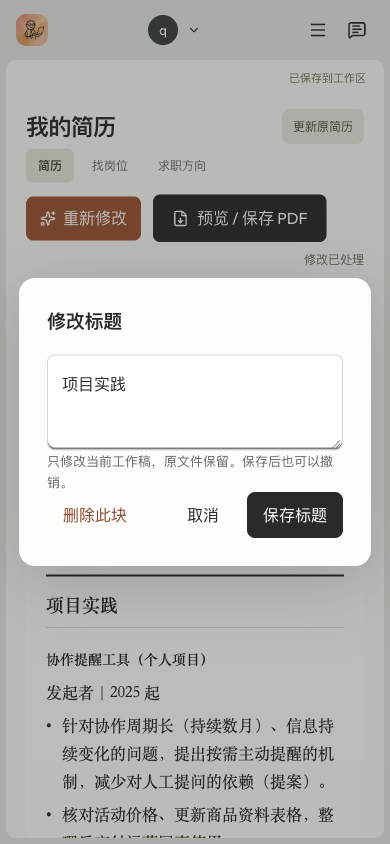

# 简历区块编辑与随笔式表述：修复验收

日期：2026-10-16。范围限定用户三张截图：随笔式 bullet、区块无法删除、只有标题的区块点击编辑无响应。保留左栏，不静默修改真人原简历和旧作答。

**已正式发布：运行提交 44c054e，部署 dpl_5RwScfbdVYRz9xJ2qBCdBSunuHSA。**

## 原因与修改

- 截图中的“2025 年 11 月提出心跳机制的重要性”已存在于来源文本，不是该条记录里新的 AI 建议；但改稿仍应识别并改善它，不能把原文来源当作质量合格的理由。起草、独立复核、无需修改判断共用编辑标准：具体问题与已有提案先写清，提案不能变成上线成果，不能把空泛“提出重要性”当交付。确有缺口再单问推进阶段，不据此停掉安全改稿。
- 原编辑器从区块正文取文字；标题区块正文为空便直接返回。现单独识别标题，打开紧凑输入并保存 Markdown 层级；无法定位时显示原因，不再静默。
- 原前后两层拒绝空文本，没有删除入口。现编辑器内提供“删除此块”，删空后也进入相同确认；取消保持输入，确认只改当前工作稿并支持持久撤销/重做。唯一条目删除时移除空标题，共享标题仍有其他条目则保留。最后一个区块删除存为可撤销的空结果决定，避免空 source 的防误删保存逻辑恢复旧文。
- 不给纸面新增常驻删除按钮、卡片或工具栏，自动设计钩子未开启。已采纳内容仍能编辑。

## 真实 Chrome 方法

独立已授权 Chrome CDP 窗口，正常免费邀请码登录，虚构资料及 `example.invalid` 邮箱。候选部署仅以已有 Vercel CLI 身份建立限定候选域的保护会话；不关闭部署保护，不复制真人 Cookie。未手调额度、购买套餐或调用真人付费推荐。

### A：提案与普通职责，无 JD

原提案故意包含日期、“提出重要性”、长解释；另有冗长但具体的运营职责。先实测标题改名、删除内容创作区块、邻块手改，再真实调用 StepFun `step-3.7-flash` 起草与独立检查，约 75.6 秒。交付两处：

> 针对协作周期长（持续数月）、信息持续变化的问题，提出按需主动提醒的机制，减少对人工提问的依赖（提案）。
>
> 核对活动价格、更新商品资料表格，整理后交付运营同事使用。

保留提案阶段，没有写上线/增长/已取得效果；手改教育与技能保留，先前删除的内容创作块未复活。两处分别采纳后保存、刷新全文一致。

### B：没有通过的中间结果

已有清楚的课程原型/12 项组件测试。首候选 cbeed5b 的真实模型约 50.4 秒把“组件测试”扩成“组件测试用例”，又加“两类场景”，独立检查误判有价值。该候选没有采纳，不能算质量通过。补丁 f36cc0b 将短句的有限扩写纳入保守相似改写拦截，并加强起草和复核对解释性赘词的要求；已有真实补充仍走专门入口，不被该规则阻断，实质缩短/拆长段仍保留。

### C：首轮校验失败，真实重试通了，但内容价值仍未通过

f36cc0b 首轮约 52.7 秒，任务明确 failed，未扣成功额度，原稿完整保留；实际点“从已保存材料继续”约 63.1 秒后 ready，证明真实失败重试链路走通。但是建议仅将“使用 React 和 TypeScript 完成图书列表与预约表单两个页面，目前是课程原型”换成“基于 React 和 TypeScript 开发图书列表页、预约表单页，为课程项目原型”，独立检查再次放行。这条没有采纳，不签收质量。

因此再将相近短句的保守编辑距离限额由 30% 调至 40%，仍要求长度/结构接近、无当前正向补充；实际大幅精简与长段拆分继续可过。补充回归明确保护实质新信息，提示词加入该反例而不是把专业动词当价值。该启发式不等同语义证明。

### D：最终对照复验

44c054e 上同一份课程项目样本重新以独立 QA 账号真实运行，约 77.1 秒，最终 ready、`unchanged:true`、`changes:[]`。独立检查后明确“已检查，当前内容可以保留。本轮没有新增修改；仍可直接编辑或导出。”刷新后状态和全文不变；数据库回查免费改稿仍 1 次、付费改稿 0，没有把失败或无需修改当成功扣额。实际 PDF 一页 A4，46,337 bytes；课程原型、12 项测试与同学复核均在，整页无裁切/重叠/编辑按钮。

## 交互与输出证据

- 标题点击 → 改名 → PATCH 200 → 刷新后仍在。
- 正文删空 → 删除确认 → 取消后空输入仍在 → 再确认删除 → PATCH 200 → 刷新仍删除；撤销/重做均存储，邻块继续可编辑。
- 仅当前 QA 页阻断保存请求，显式提示“云端保存失败”；恢复请求后点“重试保存”，PATCH 200，刷新全文一致。这是受控保存网络故障，不冒充模型真实超时。
- 390×844 手机标题弹窗 x=19、宽352，无水平溢出；正文可读，删除/取消/保存可达。左栏未改。
- A 从实际导出窗口写出一页 A4 PDF，50,697 bytes；文字层与整页渲染已检查，无删除内容、编辑按钮、横向裁切或重叠。最终版本及正式站 PDF 复验另记录。
- 最终候选重新登录 A，直接删除已采纳 AI 修改的整个项目区块，刷新仍删除；再撤销、刷新，全文与删除前一致。不是只验证未采纳的原文块。

[提案改稿 PDF](assets/resume-block-editing-20261016/proposal.pdf) · [保留原文 PDF](assets/resume-block-editing-20261016/unchanged.pdf)

## 自动检查与边界

- 最终 227 套、2,238 项通过，5 套/8 项 opt-in live 跳过。类型、修改文件 ESLint、diff 检查及云构建通过。
- 本次两处 UI 文件手动 Impeccable detect 一次：仅 3 个历史阴影/遮罩颜色与圆角 advisory，无新主要项；sidecar 路径/上下文旧状态未扩大修复。未反复扫描。
- 相似改写判断是保守规则，不是通用语义证明；两类材料不代表所有行业、所有模型已稳定。原件上传/替换、本轮未触发的补问流程以及其他聊天改稿入口不借本轮扩大签收。
- 不静默回写用户截图中的现有简历；发布后用户可重新修改或直接编辑。旧作答另做全行校验。

## 发布与清理

- 44c054e 构建为 `dpl_5RwScfbdVYRz9xJ2qBCdBSunuHSA`，通过最终候选验收后 promote。www 与裸域均查询为同一 READY 部署，health `ok:true,database:ok`，匿名 resume-agent 401。最终部署近 10 分钟 error 限定查询无返回，不代表长期稳定性统计。
- 正式 `www.ai-job-coach.xin` 正常登录 A，再实际删除已采纳项目 → 刷新 → 撤销 → 刷新，全文恢复；重新导出 PDF。随后正常登录 D，明确无需修改状态与全文刷新一致，再导出。两份正式 PDF 重新渲染与已逐页目视的候选 PNG 字节一致。
- 四组 a–d 测试账号均正常退出；按事先读回的精确 ID/email 清理 4 个 public/auth 用户、4 邀请码、免费测试额度与级联机会/任务/材料/claims/artifacts，回查全部 0。无云端原件上传；测试虚构样本 PDF 与截图保留，可按材料重建，不保留活动测试账号。保留不含正文的 5 个 trace 与 12 项模型用量审计。清除仅本轮三个候选域的 Vercel 保护会话，未清用户浏览器会话。
- 旧 `interview_answers` 前、中、后均 41 条，整行 JSONB 按 id 聚合 MD5 为 `9e144836009b5eb9bfe09dec0ac90d32`，未修改旧作答。
- 产品在独立 `codex/resume-block-repair-1016` 工作树，仅本任务文件提交；没有混入主工作树的认证/支付改动。ME 三处业务状态保留共享工作树，不提交已有其他会话暂存内容。
