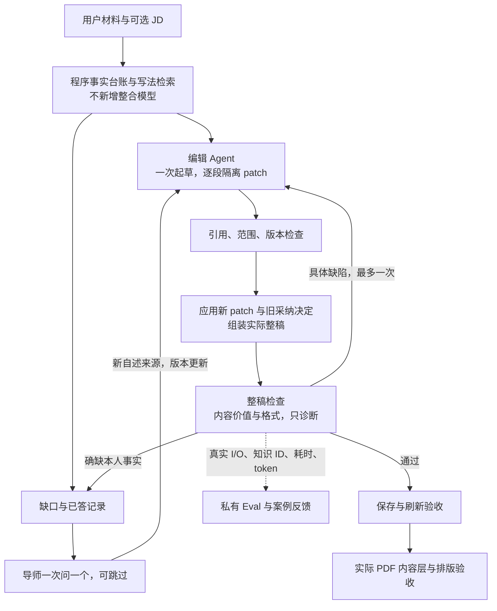

# 简历改稿与 Eval：实施和验收入口

2026-10-19。本人已批准实施，先不增加知识整合 Agent。代码在 `codex/resume-detail-polish-1017`；联合验收后正式运行代码 `6d743b5` 已发布至 `https://yizhioffer.com`，部署 `dpl_2Tnu4P7EXiE67hp24R5bGdVhbnGy`。Q 点只接收四个 Eval 页面文件，其他作战盘在途改动不混入本包。真实浏览器、实际 PDF、反馈落库/刷新及旧数据保护证据见 `docs/operations/2026-10-19-eval-delivery-acceptance.md`。

## 从 bad case 调整什么

案例 `YZ-CASE-20261019-001` 的具体问题不是列表圆点没了，而是修改删掉了加粗段首概括，整稿不一致。原反馈明确认可大部分内容，不应撤回全部内容改善。运行 `9d94e3ea-3b07-4ced-b635-ac68a3038b96`、内部 Trace `42f131d8-92b6-448f-a3a7-5ce0f95f8798`、修改 `ai-change-1792371107015-2` 保留关联。

该反馈已经存入私有后台，反馈 ID `6c05f797-6ad8-4cf1-80d4-79f83c1b42f1`，已回读核对；不是只有 localStorage。Q 点页面经独立修复与验收后已整合，正式 `/admin/evals` 的“案例反馈”支持运行/修改关联保存，真实浏览器提交、服务回执及整页刷新已验；旧“保存判断到本机”保留并明确与云端反馈区分。

编辑器保留原稿段首概括/列表层级；空泛概括应重写，而不是整份去掉概括。事实守卫先于语义质检。整稿检查读取应用修改后的候选，包括历史采纳决定；返回问题，不返回 `after` 或替换正文。过滤候选导致最终稿变化时，独立方案另查最终保留稿；不会因剩下一条建议就自动把整稿判通过。原任务 CAS/lease 与原文映射保护继续生效，不覆盖并发手工编辑。

原稿已经清楚时允许 unchanged，不凑修改；模型把“无需改”误判为“缺信息”时，在有界最后一次尝试确认原稿。明确缺口或尚未处理的回答不能走这个捷径。安全修改先完成，导师通过既有任务状态保存补问，一次一问，已答/跳过不重复。不要求100分或每条量化。

## 三个真实执行分支

|策略|主链|边界|
|---|---|---|
|independent|编辑 → 独立整稿检查 → 最多一次返修/复查|默认候选；检查只诊断。过滤后整稿改变时另验最终稿，不把旧判断套给新文。|
|self_review|原编辑同一次 JSON 返回自查|不新增质检调用；自查和独立检查明确区分，缺字段不冒称通过。|
|format_only|编辑 → 确定性格式检查|不称内容质量通过；共同事实守卫仍在，不能为了比较关闭事实安全。|

通常调用数分别为2/1/1；返修、未改确认、系统失败会改变次数，必须按实录计。不是按 Agent 名字估算费用。三种分支的替代策略仅供服务端实验；公网改稿请求不能传入隔离扣费或绕过检查参数。

## 格式策略

- preserve：默认继承原稿层级、列表和概括；不强加领句。
- repair：保留章节，只修已有条目不一致，不整份换模板。
- standard：仅作为显式授权的实验策略，用简洁条目约定，不默认替用户换稿。

以上是文本/Markdown结构，不是原PDF几何还原。纯文本已丢失的字体、表格、分页不能靠 LLM 恢复。格式策略选定也不等于已验证实际导出。

## 真实实验和计量

入口 `scripts/run-resume-workflow-eval.ts`，默认仅打印计划；执行需要项目模型费用确认环境变量。使用同一个 `runResumeDraft` 核心，不走原账号的收费端点：禁止旧岗位/任务 ID，模型上下文不带用户 ID，不读取用户 TokenPay 凭据，使用站点模型 Key；只有新 Eval、元数据 Trace 和模型用量记录。旧作答、岗位资料和积分钱包无写入。

模型固定 DeepSeek V4 Flash，温度和共同知识一致；失败、缓存、重试、schema错误均保留。每批保存 workflow/fixture/hash，后续增加执行源文件 hash，不能在已有批次下偷偷换版本重跑。实测是站点直连模型路径，不冒充用户所有自选网关模型均已通过。

批次索引（全部已入私有后台，不是演示数据）：

|批次|用途|解释边界|
|---|---|---|
|e82bf63d-17b2-4a6b-976d-15523278fa4f|v1初跑，26次真实运行|暴露新旧JSON输出契约冲突；保留失败，不作架构优劣结论。|
|ba7f388d-111a-4843-8461-64942e179c18|v2开发复测，14次|独立方案已验证安全编辑、保留领句与补问后续改；自查仍暴露字段组织问题。|
|ef89ed0e-4c3f-45a9-85f0-751500124c45|v3六类样本，18次后中断|一次写入异常导致停止；未对失败插入启动模型。标 partial，不归因为“内存满”，不悄悄重跑。|
|330840f5-c387-4c7a-be56-b803795c4566|v4新增三份留出样本，9次|行政/客服可交付；已有清楚交付的样本三个方案均补问，揭示过度提问。此后该例降为回归例，不再称未见留出集。|
|71a4a08d-f794-47ba-8fe6-206d96a8f686|v5针对过度提问回归，3次|只修needs_detail分支不足：空changes带可选问题仍会阻断，保留失败。|
|a1216d4e-2567-4fba-b2b3-73a5ec8375be|v6同例三方案复测，3次|独立检查确认原稿可保留；自查失败、仅格式仍补问，不能隐去这些结果。|
|003dc73d-7f91-4f1a-b280-bb30f523054f|v6默认方案最终定向回归，4次|提案、普通运营、薄材料先改+一问、回答后续改均形成结果；不代表浏览器或PDF验收。|

合计77条真实运行、136次逻辑模型调用，含开发失败与版本迭代，不能称77条验收全通过。实录输入653,185 / 输出37,375 tokens；代码费率估算合计约USD0.05829，0条实际结算金额记录，故不称实际花费。不从原账号积分钱包扣除。不同版本、缓存与样本结构不同，不直接把批次混成排行榜。

每个运行保存正式 run ID、内部 Trace、输入、Agent 可见 I/O、检索知识 ID、最终结果、HTTP/失败状态、调用次数、wall ms、输入/输出/缓存 token、费用估算来源。没有账单就是 actualCost=null，不能拿估价当实扣。反馈接口读取/保存、实验读取和汇总都不调用模型。

除了质量/成本/时间，还记录：事实否决、格式回退、过度改写、补问是否单一/必要、回答是否吸收、返修是否收敛、重复运行稳定性、模型/基础设施/存储失败分类。语义价值和事实硬风险留给独立盲评，不由程序长度分冒充。真实运行与离线评估成本分开。

实践参考：[Anthropic agent eval 指南](https://www.anthropic.com/engineering/demystifying-evals-for-ai-agents)支持确定性检查、模型判断、人工校准互补，以及看多次稳定性而非只挑成功；[基础设施噪声分析](https://www.anthropic.com/engineering/infrastructure-noise)提示记录超时与执行条件，不把系统故障直接当模型能力。这里样本少，只报描述性结果，不给可靠总体p95或“最佳架构”结论。

## 后台权限和反馈

`/api/admin/eval-feedback` 使用现有管理员权限；归属从正式run推导，具体修改必须存在于真实 rawResponse.changes。编号幂等：同内容重试回读，同编号不同内容409。仅后台确认写入后返回成功；CSRF、越权、存储失败分别拒绝。私有表RLS开启，不给anon/authenticated权限。新表的service_role权限也按用途收窄。

`/api/admin/eval-experiments` 只读、按批次展示；列表投影结果，不把全部阶段prompt一次拉进内存。完整 I/O 仍从单条运行入口看。历史缺失继续显示未采集；不补造旧Trace。

## 外包和发布门槛

Q 点四文件范围和接口见 `2026-10-19-eval-outsourcing.md`。不碰作战盘在途前端，不代它部署。Grok只读取生成的 `grok-blind/` 虚构输入与匿名候选，输出带证据的维度判断；不读父目录策略/分数/成本和答案键，不改代码。其他需要读事实、并发状态、私有权限和计费边界的工作留在主任务，审查成本不低于自己实现。

当前不能发布：默认方案过度提问的定向回归已过，仍需Grok/负责人校准，接Q点页面，Chrome验证案例云保存/刷新和业务稿件保存/刷新，以及实际PDF。新增私有存储表与反馈不代表网站入口已经上线。旧账号作答/资料/积分以操作前后的行数和整行hash核对；发布从干净任务归档进行，不夹带共享工作树改动。

本轮保护回读：41条旧作答hash `0881efbb0a4a159ba1e7b5460c6007d8`；全站33岗位/资料hash `10387ab8df982aabc46f6e5acd85d09f`；本人10条hash `ae949dcd2e71a2bd443842ed6af7e853`，均与操作前相同。三类积分表仍0行、额度表1行hash `cd817ec604403486f55a76c0c5390b54` 不变。应用用户59/Auth99不变。本轮未登录、发短信、支付、兑换或修改原稿。
