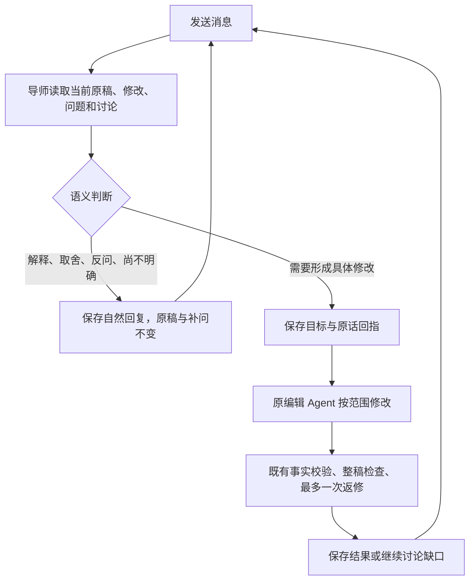

# 简历导师：先讨论，由 Agent 决定何时编辑

本人要求：“改简历的对话框这里，每次发送消息就触发修改简历了，不要这样，还是要和用户讨论，至于什么时候触发改简历 agent 自己判断说了算”。

## 行为与边界

不以关键词或前端按钮判断消息是事实答案。导师可直接回答“为什么”，接受“先别改”，自主推进已明确的修改；不要求每次固定确认口令。明显冗余可精简，原句已清楚时不为了执行而增删连接词。顶部明确开始/重试和跳过补问仍是显式操作，不改成每次都要讨论。

消息走 `action=message`，不是原 `answer/revise`。讨论不申请编辑 lease、不写简历、不写事实或面试作答；前端显示“导师正在思考”，只有服务器实际进入 running 才显示改稿。讨论中的手工修改仍可自动保存，来源变化会拒绝迟到改稿。补问不是强制问卷，用户反问不会被伪装成回答。

`coach_resume_tasks.conversation` 为服务端私有 JSONB，默认空数组，保留原 RLS/授权。它不改变旧 answers/result；原 finish RPC 只更新既有列，所以不会丢讨论。UI 只收到消息、回复和状态，不暴露编辑计划。修改目标是 instruction；确有新自述时，仅允许逐字引用用户消息且锚定原文的补充，单独形成 self_reported claim，不能引用导师回复。所有权、版本 CAS、稳定消息编号、处理中拦并发、失败重试、原有租约/源码版本保护继续有效。

对话走既有 chat 额度，若导师决定改稿，编辑再走既有 resume 额度；不是免费意图分类，也不伪称整条链只一次调用。失败释放各自预留，已完成的讨论和已完成的编辑不因响应丢失重复调用。隔离回归不用用户网关或积分。

## 真实模型验收

`scripts/eval-resume-conversation.ts` 默认只列计划；执行需 `EVAL_SITE_MODEL_COST_ACK=1` 和既有私有 Eval 归属。只用虚构简历，禁止用户岗位/任务 ID，记录真实模型 I/O、写法知识 ID、实际耗时/token和估价；不发短信/支付/兑换。CLI 测试使用 `test/register-server-only.cjs` 解释 Next 的 bundler-only 标记，不进入应用入口。

- 首批 `3b828f80-f38b-455e-95cd-16a84a9c5283`：8/8 意图判断匹配，12 次调用；两条编辑未交付，失败保留。第一条原句已清楚，只增删连接词被拒；后续将“明确精简”样本改为实际冗长的句子，样本不是盲测或同一输入的胜负对比。第二条是来源去标点跨逗号传递 ROLE 的事实守卫误拒。
- 修复守卫作用域而非放宽事实规则，版本升到 citation-verifier-v3。新增“原句应能回指自身”及参与/带空格参与/计划/协助仍不得删除的反例；原20条语料零漏放、零误杀。
- 最终批 `391b26cf-0d0a-4d0b-94e5-7c05e1e5677d`：8/8 匹配，5条仅讨论、3条决定编辑；其中两条实际进入原编辑和独立整稿检查，均有非空修改、documentReview passed。12次逻辑调用，代码估价 USD 0.0054788832，actualCost=null，不称实际账单。
- 解释：`993d60ad-ab7d-4756-bae6-2b1142151c8d`；先不改：`67bc4605-b5cc-4d1f-88d5-3789a371b22b`；反问补问：`fe61b24d-fc74-4ffe-b5aa-ebefc226cda2`；未知指标先讨论：`c3a453e9-cf68-4eae-b14c-05b6232202a5`。
- 精简后实际编辑：`714cfff0-b24e-4cf3-a2d1-fbcc704160e5`；事实补充后实际编辑：`aeceeb7b-2a04-41f1-8d98-bd55d126bd94`；讨论后授权：`2f0a8816-aeac-48b0-b9b2-04016aaddcb6`；假设非事实：`1be268e1-8ec1-4fc2-b345-ecd2e2a0ecc4`。

每条已存入原私有 Eval 后台，不补造历史 I/O。正式本人白名单请求将导师决策与随后编辑/检查共用观察 scope，避免二次模型采样；对话过程以消息编号串联，模型 span 单独命名“简历导师 · 对话决策”。

## 浏览器、数据与发布记录

Chrome 扩展连接本轮不可用，已改用原生 Chrome 完成同一 UI 验收：隔离本机真实组件，保存失败留输入、同消息重试后显示讨论、编辑调用0、整页刷新恢复；桌面及 DevTools Responsive 390×844 可读，无新增卡片/灰框。这里只是本机夹具状态恢复，不冒充正式账号发送或云消息写入；模型与服务端持久化/越权/并发分别有独立回归。截图在 `/tmp/yizhi-resume-conversation.Ho6Sxh/qa-{desktop,mobile}.png`。手动 Impeccable detect 一次，3个修改的UI文件4 advisory/0 primary，hooks保持关闭。

生产增量迁移 `20261020072132_resume_mentor_conversation` 已由 Supabase MCP 应用并核验默认值/列名，7条原任务均空讨论；原 answers/result 聚合 hash `000c2477197d0e63bb99b30825b499d5` 未变。生产 schema 快照只增此列及验证注记，避免代码假客户端通过而线上缺列。Advisors 的私有服务表 RLS 无公共policy为既有服务端隔离设计，未添加对外授权；Auth漏密码保护告警与本轮无关，未借此改认证配置。

操作前原41作答 hash `0881efbb0a4a159ba1e7b5460c6007d8`，33工作区 hash `1c01718b0539862de2a2dfc83a941512`。隔离模型运行前钱包1条 `9f0a14c3f65873c86b7ffb2e9ba86a70`、转入1条 `58f4919a216eb69d8e9125690f760a76`、预留6条 `28a8a594873473606e21a6692d971fc0`（按整行文本排序）作为本轮基线；不沿用上一日0行旧值。正式发布与最终回读待完成后追加。不复测未改的PDF、短信或支付，不把此任务扩大为这些流程的验收。

## 最终发布前复核（2026-10-20）

- Eval 优化已独立上线 `13f8e83` / H881…，本次从其报告提交 `453cda0` 干净归档，明确叠加本任务 27 个文件，不回退后台改动。
- 补齐“导师决策已保存、编辑尚未启动”的重试恢复：复用已验证决策，不重跑导师；编辑指令、事实补充与生成租约同一次 CAS 写入，消除先消费指令、后取租约的中断窗口。已领取的编辑不因同消息重放再次执行。
- 最终全量回归：2527 通过、10 跳过、4 个既有 JD 导入失败（Manus/Greenhouse/Lever/Ashby），无新增失败；类型通过，指定 lint 0错误/2旧未用变量警告。原型 UI 初检后最终复核一次，仍 0 primary /4 advisory，hooks 不开启。
- 增量 schema 已在前轮应用；本轮再次确认 conversation JSONB 默认空数组，不重复迁移、不改 RLS/授权。
- 发布前六组业务数据聚合 hash 与前轮基线全部一致：41旧作答、33工作区、7原任务 answers/result、钱包1、转入1、预留6。检查只读，无真实用户模型/积分调用。
- 真实模型结果沿用上述已存后台的最终 8 条意图、2 条实际编辑/复核，不为本轮重测无关模型而重复花费；本轮新增恢复分支由真实路由控制器测试与带 CAS 语义的存储回归验证。不把本机夹具状态恢复冒称正式账号已发送。

最终部署与浏览器只读刷新结果将在发布后追加。

## 已上线与正式回读

最终代码 `2bf716f`，干净 Production 部署 `dpl_ABsjkAUxojkeRDhrjRfkiafeiNB4`，135 页构建/类型检查通过；元数据逐项核对项目、Production、READY、sourceCommit。候选 READY 后重新验证 health database=ok、匿名 resume-agent=401；此前构建中返回的等待页不算通过。fresh 正式仍 H881… 后，同一已测试构建 promote 至 `https://yizhioffer.com`，正式 inspect 精确回读 ABsj…，health=200/database=ok，匿名 resume-agent 与 eval-runs 均401。

Chrome 原账号整页刷新：原8岗位仍在，右侧已由旧“你想先调整哪里”变成“想聊聊这份简历？”、“可以讨论写法、问问原因，或补充真实经历。需要修改时，导师会接着改。”新输入框可用，未替本人发送消息、领取编辑或消费额度。本人原来的失败记录仍保留，不伪称重跑已成功。正式界面回读与本机讨论/失败/刷新交互测试、真实模型语义测试是三种独立证据，不互相冒充。

补充完整路由接线回归：消息只进入导师，不自动 claim；仅导师回调才领取并完成原编辑。与控制器、存储恢复三套定向合计35/35。补充仅测试代码，不改变已部署运行时代码；全量2527/10跳/4旧失败仍按其真实运行记录，不推算重跑结果。

正式截图 `/tmp/yizhi-resume-discussion-final.WlNe6G/production-discussion.png` 只保留讨论输入区，不含简历联系方式；包含原文的整窗中间截图精确删除。保留正式工作区与 Eval 页，未新增设备仿真或改变视口。近5分钟部署error日志0，既有Drains缺口未改变，不称长期监控齐备。

正式刷新后再次只读核验：原41作答、33工作区、7任务 answers/result、钱包1/转入1/预留6的整行聚合hash全与发布前及模型隔离前基线一致。本人旧作答、简历、积分没有被本轮改写。迁移只为前轮新增默认空数组的私有 conversation 列，本轮未再迁移或修改认证/授权。PDF、短信、支付未改且未重测。临时密钥环境文件已清理，本轮未重新拉取；未发布任何本机QA页面。ME仅交接不混提交。
